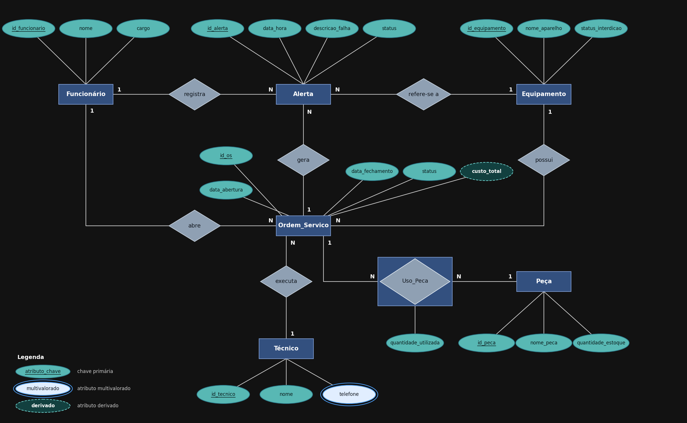

### 1. Entidades

* **Funcionário:** Representa as pessoas que trabalham na academia (professores, recepcionistas e gestores). Qualquer funcionário pode registrar alertas de avaria, e os gestores também abrem as ordens de serviço.
* **Equipamento:** Entidade forte que representa os aparelhos de musculação e aeróbicos (esteiras, bicicletas, etc).
* **Alerta:** Entidade que registra o aviso de avaria feito por um funcionário sobre um equipamento. Passa por uma triagem do gestor, que decide se o alerta gera uma Ordem de Serviço ou se é descartado.
* **Ordem_Servico:** Entidade que gerencia o conserto e a interdição do equipamento. É aberta por um gestor, a partir de um ou mais alertas procedentes, e atribuída a um técnico.
* **Técnico:** Entidade forte que representa o profissional alocado para realizar a manutenção.
* **Peça:** Entidade forte que representa os itens de reposição disponíveis no estoque.
* **Uso_Peca:** Uma entidade associativa criada para resolver um relacionamento de muitos para muitos (N:M) entre Ordem_Servico e Peça.

### 2. Relacionamentos e Cardinalidades

Associações entre as entidades identificadas, indicando a cardinalidade de cada lado:

* **[Funcionário] (1) registra (N) [Alerta]**
  * **Explicação:** Um funcionário pode registrar vários (N) alertas ao longo do tempo, mas cada alerta é registrado por apenas 1 funcionário específico.
* **[Alerta] (N) refere-se a (1) [Equipamento]**
  * **Explicação:** Um equipamento pode receber vários (N) alertas diferentes, mas um alerta refere-se a apenas 1 equipamento.
* **[Alerta] (N) gera (1) [Ordem_Servico]** *(novo)*
  * **Explicação:** Uma ordem de serviço pode ser originada por vários (N) alertas (a mesma falha reportada por pessoas diferentes), mas cada alerta é atendido por no máximo 1 ordem de serviço. A participação do Alerta é **parcial**, pois alertas improcedentes (duplicados ou sem necessidade de reparo) são descartados na triagem e nunca geram OS.
* **[Funcionário] (1) abre (N) [Ordem_Servico]** *(novo)*
  * **Explicação:** O gestor (funcionário com cargo de gestão) pode abrir várias (N) ordens de serviço, mas cada OS é aberta por apenas 1 funcionário, o que permite saber quem autorizou cada manutenção.
* **[Equipamento] (1) possui (N) [Ordem_Servico]**
  * **Explicação:** Um equipamento pode ter um histórico com N ordens de serviço, mas cada ordem de serviço pertence a apenas 1 equipamento.
* **[Técnico] (1) executa (N) [Ordem_Servico]**
  * **Explicação:** Um técnico executa N ordens de serviço, mas assumimos que cada ordem é executada por 1 técnico responsável.
* **[Ordem_Servico] (N:M) utiliza (N:M) [Peça]**
  * **Explicação:** Uma ordem de serviço pode utilizar várias peças, e uma mesma peça (ex: parafuso) pode ser usada em várias ordens de serviço. No modelo lógico, essa relação N:M exige a criação da Entidade Associativa "Uso_Peca": Ordem_Servico (1:N) Uso_Peca e Peça (1:N) Uso_Peca.

> **Observação:** a Ordem_Servico se liga ao Equipamento de duas formas: diretamente (`possui`) e indiretamente, via Alerta (`gera` + `refere-se a`). Isso é intencional: uma OS também pode ser aberta sem alerta prévio, como em uma manutenção preventiva.

### 3. Atributos

Para cada entidade, estas são as características ou propriedades que qualificam a entidade:

* **Funcionário:** `ID_Funcionario` (Chave Primária), `Nome` (Atributo Simples), `Cargo` (Atributo Simples).
* **Equipamento:** `ID_Equipamento` (Chave Primária), `Nome_Aparelho` (Atributo Simples), `Status_Interdicao` (Atributo Simples).
* **Alerta:** `ID_Alerta` (Chave Primária), `Data_Hora` (Atributo Simples), `Descricao_Falha` (Atributo Simples), `Status` (Atributo Simples, **novo**: Pendente, Em atendimento ou Descartado).
* **Ordem_Servico:** `ID_OS` (Chave Primária), `Data_Abertura` (Atributo Simples), `Data_Fechamento` (Atributo Simples), `Status` (Atributo Simples, **novo**: Aberta, Em execução ou Concluída), `Custo_Total` (Atributo Derivado).
* **Técnico:** `ID_Tecnico` (Chave Primária), `Nome` (Atributo Simples), `Telefone` (Atributo Multivalorado, pois um técnico pode ter múltiplos números).
* **Peça:** `ID_Peca` (Chave Primária), `Nome_Peca` (Atributo Simples), `Quantidade_Estoque` (Atributo Simples).
* **Uso_Peca (Entidade Associativa):** `ID_OS` e `ID_Peca` (Chave Primária Composta, ambas também Chaves Estrangeiras), `Quantidade_Utilizada` (Atributo Próprio da associação).

### 4. Diagrama Entidade e Relacionamento (DER)
 

